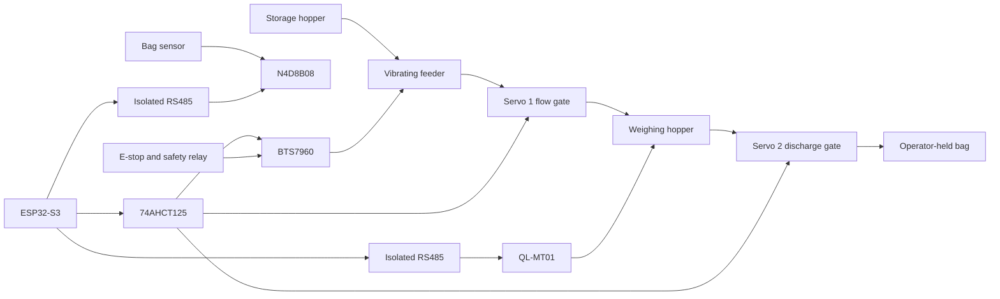

# System architecture

The machine is a local electromechanical scale. Feed leaves a storage hopper through a vibrating feeder and a servo-operated flow gate, lands in a weighing hopper, and is released by a second servo into a bag the operator holds. A photoelectric sensor reports that a bag is present. There is no bag clamp, no hopper level switch, and no servo position feedback. Hopper level is a sight glass.

The safety relay is not in the Modbus path. It drops the feeder supply even if the controller, the UART, or the I/O module has failed.

## Controller responsibilities

| Module | Owns | Does not own |
|---|---|---|
| `hardware_config` | The only GPIO, UART, and LEDC map, plus the commissioning gates | Process decisions |
| `rs485_transport` | One UART, with no DE/RE pin | Modbus or register meaning |
| `modbus` | RTU CRC, framing, and a master that refuses to transmit | Device maps |
| `weighing` | QL-MT01 adapter and its UART | Filling decisions |
| `industrial_io` | N4D8B08 adapter and its UART | The emergency-stop path |
| `servo_controller` | Commanded pulse only | A claim that the horn moved |
| `feeder_controller` | Feeder PWM and enable | When a fill should happen |
| `safety_manager` | Motion permission from a snapshot | GPIO writes |
| `machine_state` | Legal transitions | Time, I/O, and hardware |
| `machine_controller` | The only task that applies transitions and actuator commands | Wi-Fi |
| `settings` / `calibration` | Versioned NVS values | Motion |
| `diagnostics` | A RAM event log | A wall clock |
| `web_server` | Access point, HTTP, and WebSocket | GPIO and Modbus |

## Runtime tasks

Three application tasks are enough.

| Task | Priority | Period | Owns |
|---|---|---|---|
| `control` | 6 | 20 ms | State machine, safety evaluation, actuator safe outputs |
| `weigh` | 5 | 200 ms | UART1. Publishes a sample. Does not transmit in phase 1 |
| `ind_io` | 5 | 100 ms | UART2. Publishes a sample. Does not drive relays |

The HTTP server uses its own ESP-IDF task. It reads a published status snapshot and posts commands to a queue. It never takes a UART or an LEDC channel. A timeout on the weighing bus therefore cannot delay the control task, and a slow browser cannot hold a Modbus transaction.

## What phase 1 deliberately leaves closed

These are compile-time constants in `hardware_config.hpp`, not web settings:

- `kPhase1MotionEnabled`
- `kSafetyFeedbackPolarityVerified`
- `kQlMt01RegisterMapVerified`
- `kN4d8b08RegisterMapVerified`
- `kModbusTransmissionEnabled`

All five are false. Opening one is a reviewed firmware change after the matching hardware question in `OPEN_HARDWARE_QUESTIONS.md` is answered. The web API cannot set them.

## Clocks and identity

There is no battery-backed RTC in the selected hardware. Diagnostic timestamps are milliseconds since boot. The bag counter exists in the status model and stays at zero because the sequence that would increment it is not implemented.
